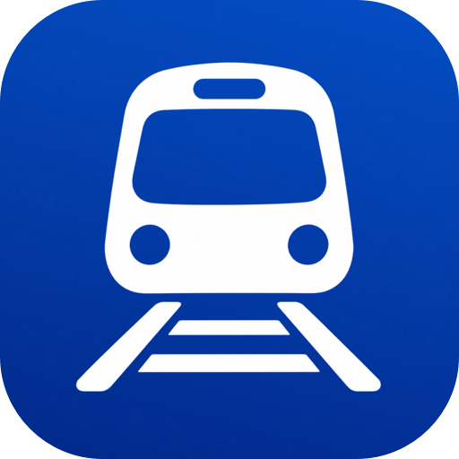

<div align="center">



# Trainy

**Live UK train tracking, from the platform to Delay Repay.**

Save the trains you're catching, watch them move on a map, get told the moment something changes,
and keep a record of every journey you've made.

<br />


<sub>
<a href="#-features">Features</a> &nbsp;·&nbsp;
<a href="#-data-sources">Data sources</a> &nbsp;·&nbsp;
<a href="#-getting-started">Getting started</a> &nbsp;·&nbsp;
<a href="#-under-the-hood">Under the hood</a> &nbsp;·&nbsp;
<a href="#-roadmap">Roadmap</a>
</sub>

</div>

<br />

## ✨ Features

<table>
<tr>
<td width="50%" valign="top">

### 🔍 Find a train
- Search any two stations, for now or any future date. Live and timetabled trains come back as one list with no duplicates.
- Routes that need a change are found too, and every train on them is followed as one journey.
- Star a route to search it again in one tap, with a shortcut for the return trip.

</td>
<td width="50%" valign="top">

### 🗺️ Follow it live
- My Trains sits on a full-screen map in a draggable sheet, with operator, times, platform and status refreshed every minute.
- Every calling point with live times, the route drawn along the real tracks and the train's estimated position.
- Share a train with someone, with a link to follow it live.

</td>
</tr>
<tr>
<td width="50%" valign="top">

### 🔔 Know when it changes
- Alerts for delays, cancellations, platform confirmations and platform changes.
- Reminders an hour and five minutes before departure.
- At a change: both platforms, Tube status across London and a reminder five minutes before you arrive.

</td>
<td width="50%" valign="top">

### 🔀 Plan B, ready
- If a delay puts a change at risk, Trainy lists the later ways to finish the journey, with a one-tap switch.
- When a train is cancelled or late, **Other Trains** shows the services that would get you there sooner.

</td>
</tr>
<tr>
<td width="50%" valign="top">

### 📲 Lock Screen and Home Screen
- **Live Activities** on the Lock Screen and Dynamic Island, for one train or a whole journey.
- A **Next Train** widget, small and medium, plus a Lock Screen version.

</td>
<td width="50%" valign="top">

### 🧳 Commute Mode
- Mark a saved route as a commute, with its days and usual departure time.
- Trainy follows that train, or the journey with a change, for you from 12 hours before.

</td>
</tr>
<tr>
<td width="50%" valign="top">

### 📜 Rail History and stats
- Finished and cancelled trains are archived automatically.
- Journeys, punctuality, minutes delayed, miles, favourite routes and operators, and journeys by month.

</td>
<td width="50%" valign="top">

### 💸 Delay Repay
- Works out which journeys qualify. A journey with a change is judged by how late it finished.
- Links to the right operator's claim page and reminds you before the window closes.

</td>
</tr>
</table>

> [!TIP]
> **Optional extras.** Turn on **iCloud sync** to keep saved trains, Rail History, routes and preferences on every device with no sign-up. Deploy the small **[server](server/README.md)** to get alerts and Live Activity updates while the app is closed, and to keep the feed keys out of the app.

<br />

## 📡 Data sources

| | Source | Used for | Notes |
|:---:|---|---|---|
| 🟢 | [**Darwin**](https://raildata.org.uk/) · National Rail via the Rail Data Marketplace | Live times, platforms, cancellations | Lists trains from about 4 hours before departure. Needs a key |
| 🕒 | [**Realtime Trains**](https://www.realtimetrains.co.uk/) | The timetable for any date, and trains Darwin has dropped | Needs a refresh token. 10 requests a minute |
| 🧭 | [**Transitous**](https://transitous.org/) | Routes with a change, and the track shape on the map | Free, no key |
| 🚇 | [**TfL Unified API**](https://api.tfl.gov.uk/) | Tube status at a London change | Free, no key |

<details>
<summary><b>How a saved train moves between feeds</b></summary>
<br />

[`TrainSync.swift`](TrainSync.swift) decides which feed each saved train is read from:

```text
 more than ~4 h before departure ──▶ Realtime Trains   timetable · every 30 min
 ~4 h before → Darwin drops it  ──▶ Darwin            live      · every minute
 after Darwin drops it          ──▶ Realtime Trains   until it's seen arriving
```

Darwin and Realtime Trains share no ID, so a train saved from the timetable is matched to its Darwin entry by origin, destination, date, scheduled departure and operator, then switched over.

</details>

<br />

## 🚀 Getting started

**You'll need** Xcode 16 or later and a device or simulator on iOS 18+. The widget extension (widgets and Live Activities) is currently set to iOS 26.2.

**1 · Clone**

```bash
git clone https://github.com/dylanGadsby1/Trainy.git
```

**2 · Add your API keys**

Sign up at [raildata.org.uk](https://raildata.org.uk) and subscribe to **Live Departure Board**, then get a Realtime Trains **refresh token** from [api-portal.rtt.io](https://api-portal.rtt.io). Copy the template:

```bash
cp Secrets.swift.example Secrets.swift
```

and fill in both values. `Secrets.swift` is git-ignored.

```swift
enum Secrets {
    static let railDataKey = "YOUR_RAIL_DATA_API_KEY"
    static let rttRefreshToken = "YOUR_RTT_REFRESH_TOKEN"
}
```

> [!WARNING]
> Realtime Trains doesn't allow its token to ship inside an app distributed to other people. That's fine on your own device, but a public release should read the feeds through the [server](server/README.md).

**3 · Run**

```bash
open Trainy.xcodeproj
```

Pick the **Trainy** scheme, choose a simulator or device and press <kbd>⌘</kbd> <kbd>R</kbd>.

> [!NOTE]
> A free Personal Team can build and run the app, but can't use iCloud or push notifications. Both need a paid Apple Developer Program membership.

<details>
<summary><b>☁️ Optional: iCloud sync</b></summary>
<br />

Without the iCloud capability, everything stays on the device. To turn sync on:

1. In Xcode, select the **Trainy** target → **Signing & Capabilities** → **+ Capability** → **iCloud**.
2. Tick **CloudKit** and add a container, such as `iCloud.com.dylangadsby.Trainy`.
3. Run the app. It finds the container on its own, and Profile → Privacy then shows **iCloud Sync**.

The `remote-notification` background mode CloudKit needs is already in `Info.plist`. Before a release, deploy the CloudKit schema to production in the CloudKit Console once the app has run with the container.

</details>

<details>
<summary><b>🛰️ Optional: the server</b></summary>
<br />

Without a server, Trainy raises its own alerts, which only happens while it's open or when iOS wakes it for a background refresh. With one, alerts and Live Activity updates arrive while the app is closed.

The server is a Cloudflare Worker in [`server/`](server/). Deploy it as described in [server/README.md](server/README.md), add the **Push Notifications** capability, and set `TrainyServerURL` (and `TrainyServerKey` if you chose one) in `Info.plist`.

</details>

<br />

## 🧩 Under the hood

The app sources sit at the repository root. The **Trainy** target compiles them, and **Trainy RTT API Live Activities** is the widget extension.

<details>
<summary><b>📱 App and screens</b></summary>
<br />

| File | What it holds |
|---|---|
| [`TrainyApp.swift`](TrainyApp.swift) | Entry point, the SwiftData container and the background refresh task |
| [`ContentView.swift`](ContentView.swift) | The map, the floating tab bar, the journey page and sharing |
| [`HomeView.swift`](HomeView.swift) | My Trains cards and `MapBottomSheet`, the custom draggable sheet with four snap points |
| [`AddTrainView.swift`](AddTrainView.swift) | Search form, station picker, results and the button that saves a train |
| [`JourneyViews.swift`](JourneyViews.swift) | Journeys with a change: connections, results, legs and missed-connection options |
| [`AlternativeTrains.swift`](AlternativeTrains.swift) | Other Trains, for when a followed train is cancelled or late |
| [`CommuteMode.swift`](CommuteMode.swift) | Commute Mode and its editor |
| [`RailHistoryView.swift`](RailHistoryView.swift) | Rail History and Delay Repay claims |
| [`RailStatsView.swift`](RailStatsView.swift) | Travel stats and the monthly chart |
| [`ProfileView.swift`](ProfileView.swift) | Profile, notification settings, privacy and about |
| [`Theme.swift`](Theme.swift) | Colours for light and dark mode, cards, labels and button styles |
| [`OperatorBranding.swift`](OperatorBranding.swift) | Logos, brand colours and Delay Repay links for each operator |

</details>

<details>
<summary><b>🔌 Data and services</b></summary>
<br />

| File | What it holds |
|---|---|
| [`DarwinAPI.swift`](DarwinAPI.swift) | Darwin client and models, plus `DarwinServiceAdapter`, the train model the whole app uses |
| [`RTTService.swift`](RTTService.swift) | Realtime Trains client |
| [`RTTModels.swift`](RTTModels.swift) | Realtime Trains models, `TrainStatus` and the UK station list |
| [`TrainSearch.swift`](TrainSearch.swift) | One search over both feeds, merged |
| [`TrainSync.swift`](TrainSync.swift) | Refreshes saved trains, hands them between feeds, archives finished ones, feeds the widget and schedules background refresh |
| [`JourneyPlanner.swift`](JourneyPlanner.swift) | Transitous route planning, journey search options and Tube status |
| [`RouteLine.swift`](RouteLine.swift) | The track shape of a journey, stored as an encoded polyline |
| [`SavedTrain.swift`](SavedTrain.swift) | SwiftData models for saved trains and saved routes, and Delay Repay eligibility |
| [`TrainAlerts.swift`](TrainAlerts.swift) | Local notifications and reminders |
| [`LiveActivityManager.swift`](LiveActivityManager.swift) | Starts, updates and ends Live Activities |
| [`CloudSync.swift`](CloudSync.swift) | Optional iCloud store, merging duplicates made on two devices, synced preferences |
| [`TrainyServer.swift`](TrainyServer.swift) | Optional server: push registration and reading the feeds through it |
| [`TrainyWidgetData.swift`](TrainyWidgetData.swift) · [`TrainyActivityAttributes.swift`](TrainyActivityAttributes.swift) | Shared with the widget extension through the App Group `group.com.dylangadsby.Trainy` |

</details>

<details>
<summary><b>🧱 Widget extension, server and leftovers</b></summary>
<br />

- **Widget extension.** [`Trainy RTT API Live Activities/`](Trainy%20RTT%20API%20Live%20Activities/) holds the Live Activity and Dynamic Island layouts and [`NextTrainWidget.swift`](Trainy%20RTT%20API%20Live%20Activities/NextTrainWidget.swift).
- **Server.** [`server/`](server/) is a Cloudflare Worker with no dependencies. A cron trigger checks every followed train against Darwin once a minute and sends APNs pushes. Device records live in Workers KV. Run the tests with `npm test` on Node 20+.
- **Leftovers.** The Python and Ruby scripts at the root (`test_*.py`, `fetch_stations*.py`, `scratch*.py`, `add_*.rb`), `rtt_openapi.yml`, `rtt_response.json`, the `ukStations_*generated.swift` files and the Swift files inside `Trainy.xcodeproj/` are from early API exploration. None of them are part of the build.

</details>

### Design notes

- **SwiftUI and SwiftData throughout**, with async/await for every network call.
- **CloudKit-safe models.** Every stored property is optional or has a default, and none is unique. Keep it that way when adding fields to `SavedTrain` or `SavedRoute`.
- **Few requests per search.** Darwin boards come with calling points included, and a Realtime Trains search takes two requests however many trains it returns, which keeps it under the 10-a-minute limit.
- **No server required.** The app works fully on its own. The server only improves alerts while the app is closed.

<br />

## 🛤️ Roadmap

- [x] Home Screen and Lock Screen widgets
- [x] iCloud sync
- [x] Push alerts while the app is closed (with the optional server)
- [ ] Apple Watch app
- [ ] Ticket wallet integration
- [ ] App Attest or similar on the server before any public release

<br />

## 🙏 Acknowledgements

Live data from [National Rail](https://www.nationalrail.co.uk/) via the Rail Data Marketplace · Timetable data from [Realtime Trains](https://www.realtimetrains.co.uk/) · Journey planning by [Transitous](https://transitous.org/), built on [open timetable data](https://transitous.org/sources/) · Tube status from [Transport for London](https://tfl.gov.uk/) · Operator logos are trademarks of their owners.

<br />

<div align="center">

<br />
<sub>Made for UK rail travellers</sub>
</div>
